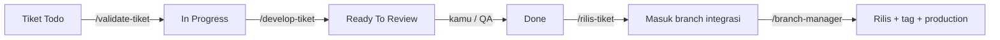

# Frontend-Agent-Workflow

Tim agen AI yang mengerjakan tiket di proyek **frontend web**, dari cek tiket sampai siap direview:



Kamu cukup mengetik satu perintah. Agen membaca tiket, menulis kode beserta tesnya, menguji di browser (laptop, tablet, HP), membuat halaman pratinjau, membuka PR, lalu menulis komentar di tiket. Keputusan penting (deploy ke production, merge, tiket ke Done) **tetap di tanganmu**.

Bisa dipakai di **Claude Code, OpenAI Codex, Gemini CLI, GitHub Copilot, Cursor, OpenCode**, atau agen coding lain yang membaca `AGENTS.md`; untuk semua project atau satu project saja.

Kit ini kembaran [kit Mobile](https://github.com/roiskhoiron/mobiledev-agent-workflow). Bedanya: device diganti browser, build aplikasi diganti deploy, Maestro diganti Playwright.

---

## 1. Pasang (sekali per komputer)

**Butuh:** satu agen coding (lihat tabel di bawah), `git`, `jq`, `python3` + Pillow, Node.js + Playwright, `gh` (GitHub) atau `glab` (GitLab) yang sudah login. Orca disarankan untuk kerja paralel.

**Platform tiket bebas:** Jira, GitHub (Issues/Projects), GitLab (Issue Board), Linear, atau lainnya. Tidak ada pilihan bawaan; agen menanyakannya di awal (lihat langkah 2). Pakai Jira atau Linear → sambungkan juga connector-nya di agen coding-mu.

```bash
pip install pillow
npm i -g playwright && npx playwright install chromium
git clone https://github.com/roiskhoiron/Frontend-Agent-Workflow.git
cd Frontend-Agent-Workflow
./install.sh             # pilih agen coding + global/project
bash tests/run.sh        # harus muncul: ALL PASS
```

Installer menanyakan dua hal: **agen coding mana** (boleh lebih dari satu) dan **global** (semua project) atau **project** (satu folder). Bisa juga langsung:

```bash
./install.sh --agent codex --scope global
./install.sh --agent claude,gemini --scope project --project ~/kode/toko-web
```

| Agen coding | Skill | Pagar keamanan otomatis |
| --- | --- | --- |
| Claude Code | ✓ | ✓ shell, edit file, tiket |
| OpenAI Codex, Gemini CLI, GitHub Copilot | ✓ | ✓ shell, edit file |
| Cursor | ✓ | ✓ shell saja |
| OpenCode, agen lain (`generic`) | ✓ | — (aturan saja) |

Mode tim (beberapa agen sekaligus) paling lengkap di Claude Code; di agen lain memakai subagent bawaannya, atau otomatis jalan solo.

`install.sh` aman dijalankan ulang. Kalau kit Mobile sudah terpasang, installer berhenti dan menyebut perintah yang bentrok; pakai `./install.sh --force` bila ingin beralih ke kit frontend. Detail: [docs/pasang.md](docs/pasang.md).

## 2. Siapkan project (sekali per project)

1. Salin template akun uji ke root project, **masukkan ke `.gitignore` dulu**, lalu isi:
   ```bash
   echo ".env.agent.local" >> .gitignore
   cp ~/path/Frontend-Agent-Workflow/templates/env.agent.local .env.agent.local
   ```
2. Jalankan perintah pertamamu. Pertanyaan pertama agen: **"Tiket project ini dikelola di mana?"** Jawab Jira, GitHub, GitLab, Linear, atau lainnya. Belum punya papan tiket atau bingung? Agen menyarankan **GitHub Projects** (repo di GitHub) atau **GitLab Issue Board** (repo di GitLab) dan memberi langkah membuatnya.

   Setelah itu agen **bertanya sekali** lalu mengingatnya: kolom/status papan yang dipakai, branch utama, hosting, server API, ukuran layar yang wajib diuji, dan tempat menyimpan laporan. Jawab saja; agen selalu memberi satu saran.
3. Claude Code + kerja tim: buka dengan `claude --teammate-mode auto`.

## 3. Pakai

| Perintah | Kapan dipakai | Hasil |
| --- | --- | --- |
| `/validate-tiket KODE` | Tiket baru di Todo: layak dikerjakan? | Laporan + screenshot bertanda, komentar di tiket, tiket ke In Progress bila layak |
| `/develop-tiket KODE` | Tiket In Progress: kerjakan | Kode + tes, laporan uji, link pratinjau, PR, tiket ke Ready To Review |
| `/rilis-tiket KODE` | Ada feedback QA di tiket | Tiket kembali ke Todo, deploy ke staging, atau PR tiket di-merge (dengan izinmu) |
| `/branch-manager --rilis KODE` | Mau rilis satu versi | Dokumen rilis, PR rilis, tag `vX.Y.Z`, deploy production (dengan izinmu) |
| `/audit-issue "keluhan"` | Ada keluhan tapi belum jadi tiket | Laporan penelusuran + saran tiket, tanpa mengubah apa pun |

```text
/validate-tiket WEB-1234
/develop-tiket WEB-1234
/develop-tiket WEB-1234 WEB-1240 --tim
/audit-issue "tombol bayar tidak muncul di Safari iPhone"
```

**Flag yang sering dipakai** (lengkapnya di [docs/alur-kerja.md](docs/alur-kerja.md)):

| Flag | Arti |
| --- | --- |
| `--solo` / `--tim` | Satu agen, atau dibagi ke tim agen. Tanpa flag, agen memilih sendiri |
| `--batch` (default) / `--separate` | Beberapa tiket diuji bersama sekali, atau tiap tiket jalan sendiri |
| `--uat` | Setelah lulus uji, kamu mencoba sendiri halaman pratinjaunya |

**Agen pasti berhenti dan bertanya sebelum:** deploy ke production, merge PR, memulai hotfix, atau bila akun uji tidak ada. Agen **tidak pernah** memindah tiket ke Done atau menutup issue.

## 4. Istilah singkat

| Istilah | Artinya |
| --- | --- |
| **KODE** | Nomor tiket, mis. `WEB-123` (Jira) atau `#123` dari GitHub/GitLab (agen menulisnya `WEB-123`) |
| **AC / TC** | Syarat selesai di tiket / langkah uji. Hasil uji: Lulus, Gagal, atau Tertahan (dengan alasan) |
| **Halaman pratinjau** | Salinan situs dari perubahan tiket, bisa dibuka siapa saja untuk dicoba |
| **Worktree tiket** | Folder kerja khusus satu tiket (`<repo>-<nomor>`), supaya beberapa tiket bisa dikerjakan bersamaan |
| **Guard** | Pagar otomatis yang menolak perintah berbahaya, mis. push ke repo utama |
| **origin / upstream** | Fork kita (agen boleh push) / repo utama (hanya lewat PR) |
| **Skill flow / skill internal** | Lima perintah di atas / langkah-langkah kecil yang dijalankan perintah itu (mis. `/test-browser`) |

## 5. Kalau ada masalah

| Muncul pesan | Lakukan |
| --- | --- |
| `DIBLOKIR oleh guard: ...` | Wajar, itu pagar bekerja. Baca pesannya; biasanya menyebut cara yang benar |
| `Jalankan dari workspace domain` | Buka workspace kerja di Orca (bukan root project), ulangi perintah |
| `belum punya daftar status` | Pilih kolom/status papan yang ditunjukkan agen untuk Todo, In Progress, Ready To Review |
| `Teammate mode mati` (Claude Code) | Buka ulang dengan `claude --teammate-mode auto` |
| Pagar tidak jalan di Codex/Gemini (scope project) | Trust project di agen itu dulu; hook project baru aktif setelah dipercaya |

Lainnya: [docs/masalah-umum.md](docs/masalah-umum.md).

## Panduan lengkap

| Halaman | Isi |
| --- | --- |
| [Alur kerja + skill set](docs/alur-kerja.md) | Langkah tiap perintah, semua flag, 34 skill internal |
| [Tim agen](docs/tim-agen.md) | Peran, nama, dan model tiap agen |
| [Pagar keamanan](docs/pagar-keamanan.md) | Yang diblokir guard dan kapan agen bertanya |
| [Alat + MCP](docs/alat.md) | Skrip `bin/`, alat uji/deploy, pembersihan otomatis |
| [Pasang](docs/pasang.md) | Pilihan agen coding + scope, apa yang dipasang per agen, bentrok dengan kit Mobile |
| [Masalah umum](docs/masalah-umum.md) | Gejala dan solusinya |
| [Rancangan dan keputusan](docs/design-summary.md) | Beda dengan Mobile, keputusan desain, pertanyaan terbuka |

## Isi repo

| Folder | Isi |
| --- | --- |
| `skills/` | 5 skill flow, 34 skill internal, aturan bersama di `skills/_shared/` |
| `agents/` | 15 peran agen |
| `hooks/` | Pagar keamanan `guard-frontend.sh` + `guard-adapter.sh` (penerjemah hook agen lain) |
| `bin/` | Skrip pembantu (kunci port/akun, screenshot bertanda, tracing rilis, pembersihan) |
| `templates/` | Template akun uji dan blok instruksi agen (`CLAUDE.md`/`AGENTS.md`/`GEMINI.md`) |
| `tests/` | Tes kit: `bash tests/run.sh` |
| `docs/` | Panduan lengkap |

**Untuk kontributor:** setiap perubahan perintah, skrip, atau aturan wajib memperbarui README atau `docs/` di commit yang sama. `tests/readme_test.sh` gagal bila ada perintah atau skrip yang belum disebut.
