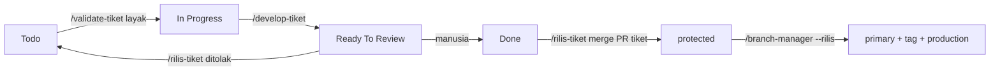
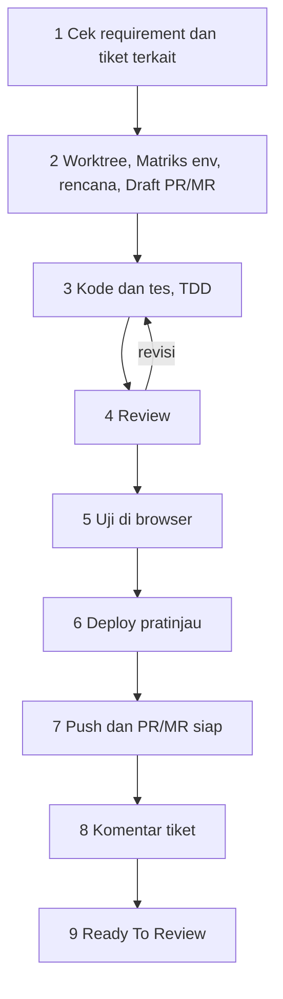

# Alur kerja

Tiket bergerak di papan kanban: **Todo → In Progress → Ready To Review → Done**. Agen tidak pernah memindah tiket ke Done; itu tugas manusia. Tiket masuk dari workflow produksi tiket.

## Perintah dan flag

| Perintah | Flag | Arti |
| --- | --- | --- |
| `/validate-tiket KODE...` | `--solo` | Satu agen mengerjakan semua |
| | `--tim` | Dibagi ke PdM, Product Designer, Contract Runner, HoE, PjM (+ Spesialis eskalasi) |
| `/develop-tiket KODE...` | `--solo` / `--tim` | Satu agen, atau tim (Planner, Coder, Reviewer, QA, Release). Tanpa flag: 1 tiket kecil = solo |
| | `--batch` (default) | Semua tiket: satu rencana, satu branch batch lokal, **satu build produksi** untuk uji, titik tunggu |
| | `--separate` | Tiap tiket jalur sendiri sampai selesai |
| | `--uat` | Setelah QA lulus, kamu mencoba sendiri URL pratinjau; agen menunggu "selesai UAT" |
| `/rilis-tiket KODE...` | — | Baca feedback QA terakhir lalu: Todo, deploy staging/production, atau merge PR tiket |
| `/branch-manager --rilis KODE` | — | Rilis satu versi (KODE = tiket tempat dokumen rilis dikomentari) |
| `/audit-issue "teks"` | `--solo` / `--tim`, lampiran | Audit hanya-baca untuk keluhan tanpa tiket |

## /develop-tiket versi web

Sembilan langkahnya sama dengan Mobile; langkah 5 dan 6 berubah: uji di browser dan deploy pratinjau.

| # | Langkah | Siapa | Hasil |
|---|---|---|---|
| 1 | Sinkron dokumen terbaru, baca tiket, laporan validasi, tiket terkait | SPV | Gerbang validasi lolos dan Acuan tiket |
| 2 | Worktree + branch tiket, Matriks env, rencana + test case, Draft PR/MR | Planner (tim) / SPV (solo), Release untuk Draft | Dokumen rencana dan Draft PR/MR |
| 3 | Kode dengan tes dulu di branch tiket | Coder | Commit di-push rutin |
| 4 | Review: keamanan sisi klien, performa, lalu logika vs AC | Reviewer | Komentar review: lolos atau revisi |
| 5 | Uji per server: Playwright dibandingkan prototipe di tiap state dan ukuran layar, Pact konsumen, aksesibilitas | QA | Laporan uji + screenshot |
| 6 | Deploy pratinjau selalu, env staging juga bila ada | Release | Link pratinjau |
| 7 | Push terakhir, Draft PR/MR ditandai siap | Release | Link PR/MR |
| 8 | Rangkum semua link di komentar tiket | Release | Komentar tiket |
| 9 | Geser tiket | Release | Ready To Review |

Frontend boleh mulai sebelum endpoint ada di server dev: Coder bekerja terhadap **mock server dari kontrak** (`/mock-api`), dan TC di server yang endpoint-nya belum ada ditandai **Tertahan**.

**Gerbang selesai per tiket:** semua TC Lulus di semua ukuran layar wajib (atau Tertahan + alasan), tidak ada pelanggaran aksesibilitas critical/serious baru, review tanpa temuan wajib, lint/typecheck/test/build lulus.

## Masukan desain
Acuan desain tiket adalah **prototipe dari workflow UI/UX** (repo desain `<proyek>-design` di GitHub Pages), bukan gambar mockup. Detail: `skills/_shared/design-input.md`.

| Yang dirujuk | Bentuk | Dipakai oleh |
|---|---|---|
| Alamat tiap state | `.../prototypes/<KODE>/<layar>.html?state=gagal` | Planner, Coder, QA |
| Halaman handover | Tujuan, perilaku, token yang dipakai, catatan per platform | Planner, Coder |
| Token hasil bangun | CSS custom properties dari Style Dictionary (`build/css/tokens.css`) | Coder |

Tiga aturan:
- **Kode prototipe tidak disalin ke produk.** Layar ditulis ulang di framework proyek, dengan prototipe sebagai rujukan perilaku dan tampilan.
- **Yang dipakai langsung hanya token.** Berkas token diambil dari repo desain, sehingga warna dan ukuran di produk sama dengan prototipe.
- **QA membandingkan halaman dengan alamat state yang sama** di prototipe, satu state demi satu state (`compare-shot.py`).

## /validate-tiket versi web
Baca tiket → reproduksi (bug) atau cek requirement/kontrak/desain (fitur) → screenshot bertanda → laporan → keputusan di tiket (**Layak** / **Layak dengan catatan** → In Progress; **Tidak layak** → tetap Todo).
- **Reproduksi di browser** dan ukuran layar yang tertulis di tiket; tidak tertulis → browser utama di desktop dan ponsel.
- **Tanda di screenshot:** kotak merah dan label kode AC dari posisi elemen di halaman, bukan ditebak.
- **Mode tim** sama dengan Mobile; Product Designer membandingkan prototipe web dengan halaman.
- **Validasi ulang** (tiket kembali ke Todo): laporan delta + bagian "Yang ditolak".

## /rilis-tiket dan /branch-manager
- `/rilis-tiket`: ditolak → izin → Todo; minta deploy → cek Matriks env → deploy staging (production: izin) ; Done → audit PR (approved, CI hijau, diff sesuai, production sesuai kontrak) → izin → merge PR tiket.
- `/branch-manager --rilis`: tracing commit → Matriks env production → deploy staging dari `<sha-rilis>` + regresi penuh → dokumen rilis → PR rilis → **kamu** memilih Konfirmasi / Tolak / Ikuti rekomendasi → manusia merge PR rilis → tag `vX.Y.Z` → deploy production (izin) → smoke live.

## Skill set di tiap flow

Skill flow memanggil skill internal secara berurutan. Skill internal tidak saling memanggil.

| Skill flow | Skill set, berurutan |
|---|---|
| `/validate-tiket` | `/setup-board`, `/setup-docs`, `/read-ticket`, `/sync-docs`, `/reproduce-browser`, `/check-contract`, `/find-related`, `/write-report`, `/post-decision` |
| `/develop-tiket` | `/gate-validation`, `/setup-worktree`, `/matrix-env`, `/write-plan`, `/mock-api`, `/implement-tdd`, `/review-code`, `/test-browser`, `/check-a11y`, `/deploy-preview`, `/open-pr`, `/post-summary`, `/move-ticket` |
| `/rilis-tiket` dan `/branch-manager --rilis` | `/read-feedback`, `/deploy-variant`, `/audit-pr`, `/release-trace`, `/run-regression`, `/write-release-notes`, `/prepare-release-pr`, `/smoke-live`, `/tag-release` |
| `/audit-issue` | `/split-questions`, `/trace-code`, `/reproduce-browser`, `/compare-attachments`, `/write-report` |

**Skill khas web** (menggantikan skill device dan build aplikasi di Mobile):

| Skill | Tugas | Menggantikan di Mobile |
|---|---|---|
| `/reproduce-browser` | Reproduksi bug di browser + screenshot bertanda | `/reproduce-device` |
| `/mock-api` | Mock server dari kontrak | — |
| `/test-browser` | Playwright di tiap ukuran layar, bandingkan dengan prototipe | `/test-device` |
| `/check-a11y` | Cek aksesibilitas halaman | — |
| `/deploy-preview` | Deploy pratinjau branch tiket | `/build-app` |
| `/deploy-variant` | Deploy staging, dan production setelah izin | `/build-variant` |

**Skill bersama** (dipakai juga oleh workflow lain): `/setup-board` (platform tiket di memory project), `/setup-docs` (platform dokumentasi), `/read-ticket`, `/sync-docs` (fetch dokumen + `graphify update`), `/check-contract` (Schemathesis + Pact), `/find-related`, `/write-report`, `/post-decision`, `/gate-validation`, `/setup-worktree`, `/matrix-env`, `/write-plan`, `/implement-tdd`, `/review-code`, `/open-pr`, `/post-summary`, `/move-ticket`, `/read-feedback`, `/audit-pr`, `/release-trace`, `/run-regression`, `/write-release-notes`, `/prepare-release-pr`, `/smoke-live`, `/tag-release`, `/split-questions`, `/trace-code`, `/compare-attachments`.

## Platform dokumentasi
Default: Markdown di folder `docs/` pada branch `agent-docs` di fork (`origin`), lewat worktree `<repo>-docs`. Link di komentar tiket = URL file itu di GitHub/GitLab. Bisa diganti Claude Docs atau platform lain lewat memory project (`/setup-docs`).

| Dokumen | Lokasi default |
|---|---|
| Laporan validasi | `docs/tickets/<KODE>/validasi.md` |
| Rencana dan test case | `docs/tickets/<KODE>/rencana.md` |
| Laporan uji dan screenshot | `docs/tickets/<KODE>/uji.md` dan `docs/tickets/<KODE>/img/` |
| Laporan audit | `docs/audit/` |
| Perubahan rilis | `docs/rilis/vX.Y.Z.md` |

---
[← kembali ke README](../README.md)
