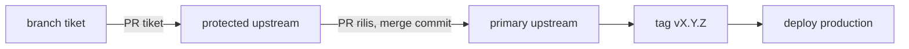

# Deploy, PR/MR, dan rilis

Hanya **Release** yang men-deploy, membuat/menandai PR/MR, merge PR tiket (setelah izin), dan memberi tag. Coder hanya push branch tiketnya ke `origin`.

## Versi tanpa nomor build
Web tidak punya nomor build. Setiap deploy dikenali dari **hash commit** (`git rev-parse --short HEAD`) dan URL deploy-nya; rilis dari tag `vX.Y.Z`. Hash + URL + env API ditulis di laporan uji, PR/MR, dan komentar tiket.

## Jenis deploy
| Jenis | Kapan | Siapa | Gerbang |
|---|---|---|---|
| Pratinjau (env dev) | selalu, per tiket (atau per batch) setelah QA lokal lulus | Release (`/deploy-preview`) | — |
| Pratinjau env staging | juga, bila project punya pemetaan env staging | Release (`/deploy-preview`) | Matriks env staging tidak **Belum ada**/**Beda kontrak** |
| Staging bersama | atas permintaan QA (`/rilis-tiket`) atau regresi rilis | Release (`/deploy-variant`) | kunci `deploy:staging`; Matriks env staging |
| Production | rilis per versi, setelah tag | Release (`/deploy-variant`) | **izin eksplisit user per deploy**; kunci `deploy:production`; smoke live sesudahnya |

## Hosting (dari memory project)
Penyedia dan caranya dicatat sekali di memory project (`/deploy-preview` menanyakannya). Contoh pola yang dikenali:

| Penyedia | Pratinjau | Production |
|---|---|---|
| Vercel (integrasi Git) | otomatis per push/PR; URL dari status check PR (`gh pr checks <n>`) atau komentar bot | merge ke `<primary>` / `vercel deploy --prod` |
| Vercel CLI | `vercel deploy` (tanpa `--prod`) dari worktree | `vercel deploy --prod` |
| Netlify | otomatis per PR (Deploy Preview) atau `netlify deploy` | `netlify deploy --prod` |
| Cloudflare Pages | otomatis per branch atau `wrangler pages deploy <dir> --branch <branch>` | `--branch <primary>` |
| Firebase Hosting | `firebase hosting:channel:deploy <KODE>` | `firebase deploy --only hosting` |
| Lainnya | perintah dari memory project | perintah dari memory project |

Token hosting dipakai dari login CLI/env mesin user, tidak pernah ditulis ke file, laporan, atau PR. Perintah gagal karena belum login → berhenti dan tanya.

## PR/MR
- Push hanya ke `origin`: `git push origin <branch>`.
- `gh` bila remote GitHub, `glab` bila GitLab (cek `git remote get-url upstream`).
- Tujuan semua PR tiket: upstream `<protected>`. Hotfix → tanya (sementara manual).
- Dibuat **Draft** di awal pengerjaan (`/open-pr` mode draft), diperbarui push rutin Coder, ditandai siap di akhir (`/open-pr` mode siap). Judul berisi KODE. Isi: ringkasan, link rencana dan laporan, Acuan tiket, Matriks env, deploy pratinjau (URL + hash + env API). Tanpa kredensial.
- Branch batch tidak pernah jadi sumber PR/MR.

## Merge PR tiket (`/rilis-tiket`, skill `/audit-pr`)
Agen merge PR tiket ke `<protected>` hanya bila **semua** syarat lolos dan user menjawab "ya"; gagal satu → lapor + saran.

| Syarat | Cara cek |
|---|---|
| Tiket Done dan punya PR/MR | platform tiket (`board.md`) + `gh pr list` / `glab mr list` |
| PR/MR approved | `gh pr view --json reviewDecision` / `glab mr view` |
| CI hijau | status check PR/MR |
| Isi diff sesuai tiket | diff vs AC; `manifest-check.sh <base> <head> KODE...` |
| Matriks env production **Sesuai kontrak** | cek ulang endpoint di server production (method aman) |

Strategi merge sesuai memory project (squash atau merge commit).

## Rilis (`/branch-manager`)

- PR rilis dari branch upstream `<protected>` ke `<primary>`, **merge commit**, **di-merge manusia**.
- Tracing: `$FRONTEND_WORKFLOW_DIR/bin/release-trace.sh <primary-ref> <protected-ref> PREFIX...` (TSV `sha7 pr kode author subject`). Exit 0 semua terlacak; 1 ada baris tak terlacak; 2 salah pakai; 3 `<primary>` bukan leluhur `<protected>` (hotfix belum di-back-merge) → berhenti dan tanya.
- `<sha-rilis>` = `git rev-parse upstream/<protected>` saat tracing: yang dilacak = yang diuji regresi = yang di-deploy production.
- Regresi penuh di **staging** dari `<sha-rilis>` sebelum user ditanya; smoke live (`@smoke-live`, baca saja) setelah deploy production.
- Production dideploy dari `<sha-rilis>` hanya setelah izin eksplisit. Bila production dideploy otomatis oleh hosting saat `<primary>` berubah, maka merge PR rilis oleh manusia **adalah** deploy production: sebut ini di pertanyaan ke user, dan smoke live jalan setelah deploy hosting selesai.
- **Keluarkan tiket dari rilis:** PR revert ke `<protected>` dari branch `revert/<KODE>-<n>` (`<n>` urut mulai 1), judul `revert: <KODE> keluar dari rilis vX.Y.Z`; merge hanya setelah "ya". Tiket itu Done lagi → PR revert-dari-revert `unrevert/<KODE>-<n>` dulu.
- Tag beranotasi `vX.Y.Z` di commit merge PR rilis, push ke `upstream` dan `origin`. Tag tidak pernah ditimpa.

## Tiket setelah rilis
Komentar (baris pertama link laporan) berisi URL deploy dan PR/MR. Done hanya oleh manusia.
