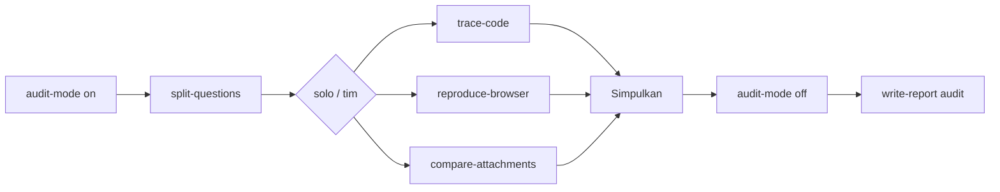

Audit permintaan di `$ARGUMENTS`: teks dalam kutip, flag `--solo`/`--tim` (opsional), lalu lampiran. Peranmu = **SPV audit**. Audit **hanya-baca**: tidak mengubah repo, tidak membuat/mengomentari/menggeser tiket, tidak deploy. Guard memaksanya selama mode audit menyala.

Baca dulu: `~/.claude/skills/_frontend-workflow-shared/rules.md`, `browser.md`, `credentials.md`, `report-format.md` (Laporan audit), dan `~/.claude/agents/{auditor,analis}.md`.

**Model:** `claude-opus-5-5` untuk semua peran.

## Langkah
0. `AGENT_LOCK_PID=$PPID "$FRONTEND_WORKFLOW_DIR/bin/audit-mode.sh" on` sebelum apa pun. Slug = `<yyyymmdd-hhmm>-<3 kata pertama, huruf kecil, spasi → ->`; `mkdir -p "${TMPDIR:-/tmp}/audit/<slug>"`. Semua file kerja hanya di sana. Baca semua lampiran (yang ditempel di chat hanya terlihat sesi ini: beri worker ringkasannya).
1. `/split-questions` → gejala, halaman, browser/ukuran, env + URL, ref versi, pertanyaan.
2. **Kerangka laporan** `${TMPDIR:-/tmp}/audit/<slug>/laporan.md` dengan semua bagian "Laporan audit" bertanda "belum diisi". Platform `claude-docs` → buat dokumennya sekarang (menulis Claude Docs tidak diblokir guard) dan kirim link ke user; `repo-markdown` → diterbitkan di langkah 6.
3. **Mode** (`--solo`/`--tim` memaksa; tanpa flag → satu halaman dan sempit = solo):
   - **Solo:** sesi ini menjalankan `/trace-code`, `/reproduce-browser` (bila menyangkut perilaku halaman), `/compare-attachments` (bila ada lampiran), berurutan.
   - **Tim:** teammate `auditor` (Cecep, Dadang, Sarip; `/trace-code`), reproduksi memakai nama QA (Paijo, ...) dengan `auditor.md` (`/reproduce-browser`), `analis` (Bu Lastri; `/compare-attachments`), semua `model: opus`. Teammate otomatis hanya-baca selama mode audit sesi ini aktif. Isi tugas: slug, ref, pertanyaan yang ditugaskan, port/akun (owner `audit-<slug>-<peran><n>`), lampiran.
   - Reproduksi memakai URL staging/production yang **sudah ada** (production: baca saja) atau server lokal dari ref versi di worktree yang ada (tanpa checkout baru); tidak bisa → "tidak bisa direproduksi di versi itu".
4. **Simpulkan** dari `${TMPDIR:-/tmp}/audit/<slug>/*.md`: akar masalah + keyakinan (**pasti** / **kuat** / **dugaan**), dampak, ukuran perbaikan; klaim tanpa bukti = dugaan. Isi `laporan.md` (atau dokumen Claude Docs) + saran tiket (tidak dibuat).
5. Hentikan teammate, lepas kunci port/akun, matikan server, lalu `AGENT_LOCK_PID=$PPID "$FRONTEND_WORKFLOW_DIR/bin/audit-mode.sh" off` sebagai panggilan Bash tersendiri.
6. `repo-markdown`: `/write-report audit <slug> ${TMPDIR:-/tmp}/audit/<slug>/laporan.md ${TMPDIR:-/tmp}/audit/<slug>` (satu-satunya tulisan, sesudah mode audit mati). Di chat: link laporan + satu kalimat kesimpulan.

## Berhenti lebih awal / galat
Hentikan teammate, lepas kunci, isi bagian yang sudah ada temuannya dan tandai sisanya belum selesai, `audit-mode.sh off`.

## Tidak pernah
Membuat/mengedit/mengomentari/menggeser tiket; commit, checkout, branch, worktree, PR/MR, edit file repo, atau menulis ke repo lewat shell selama mode audit (guard tidak menangkap `sed -i`/`>`, jadi ini tanggung jawabmu); deploy; data uji di production.
