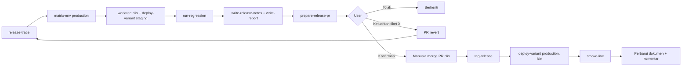

Siapkan rilis satu versi (`$ARGUMENTS`; `KODE-TIKET` = tiket tempat dokumen rilis dikomentari). Sesi ini = **Release (Agen First)**: ikuti `~/.claude/agents/release.md`. Agen mengerjakan semua langkah dulu, lalu bertanya: **Konfirmasi / Tolak / Ikuti rekomendasi agen**. Argumen selain `--rilis KODE` (mis. `--hotfix`) → belum ada, berhenti dan tanya.

Baca dulu: `~/.claude/skills/_frontend-workflow-shared/rules.md`, `deploy-release.md`, `report-format.md`, `credentials.md`, `browser.md`.

## Langkah
| # | Skill internal / tindakan | Catatan |
|---|---|---|
| 0 | `/setup-board`, `/setup-docs` | + `gh`/`glab` login; `<primary>`, `<protected>`, prefix, URL production, strategi merge dari memory. Upstream hanya squash → berhenti dan tanya |
| 1 | `/release-trace <PREFIX>` | **berhenti** (hotfix belum back-merge) → jangan buat PR rilis; catat `<sha-rilis>` |
| 2 | versi `vX.Y.Z` | dari `KODE-TIKET` atau `package.json` `version`; tidak jelas atau tag sudah ada (`git ls-remote --tags upstream vX.Y.Z`) → tanya |
| 3 | cek isi | tiket belum Done, tak terlacak → masuk rekomendasi |
| 4 | `/matrix-env --server production` | endpoint semua tiket rilis; **Belum ada**/**Beda kontrak** → rekomendasi |
| 5 | worktree rilis + `/deploy-variant staging vX.Y.Z <sha-rilis>` | `git -C <checkout> worktree add --detach ../<repo>-rilis-vX.Y.Z <sha-rilis>` |
| 6 | `/run-regression vX.Y.Z <URL staging>` | QA (`qa.md`, mode regresi penuh); suite kosong = risiko, bukan lulus |
| 7 | `/write-release-notes`, lalu `/write-report rilis` | dokumen `Perubahan rilis vX.Y.Z` |
| 8 | komentar di `KODE-TIKET` | baris pertama link dokumen, versi, jumlah perubahan, rekomendasi; `KODE-TIKET` tidak digeser |
| 9 | `/prepare-release-pr` | Draft PR rilis `<protected>` → `<primary>` |

**Tanya user** (ringkasan + hasil regresi + rekomendasi + link dokumen dan PR rilis): **Konfirmasi / Tolak / Ikuti rekomendasi agen**.
- **Tolak** → berhenti; PR rilis tetap Draft atau ditutup sesuai jawaban.
- **Ikuti rekomendasi** → kerjakan yang bisa dikerjakan agen; yang butuh manusia (tiket ke Done, back-merge) → tunggu, lalu ulang dari langkah 1.
- **Keluarkan tiket X** → PR revert (`deploy-release.md` → Rilis): branch `revert/<KODE-X>-<n>` dari `upstream/<protected>`, `git revert -m 1 <merge commit>` (atau commit squash-nya), push ke `origin`, PR ke `<protected>` berjudul `revert: <KODE-X> keluar dari rilis vX.Y.Z`; merge hanya setelah "ya"; komentar di tiket X; ulang dari langkah 1.
- **Konfirmasi** → PR rilis ditandai siap (`gh pr ready <N> --repo <upstream>`); lanjut 10.

| # | Langkah lanjutan | Catatan |
|---|---|---|
| 10 | tunggu manusia merge PR rilis | `/tag-release` melapor **belum merged** → ingatkan user, berhenti (jalankan lagi nanti; langkah selesai dilewati) |
| 11 | `/tag-release vX.Y.Z <N> <sha-rilis>` | squash → tanya; parent kedua beda → ulang dari 1 |
| 12 | `/deploy-variant production vX.Y.Z <tag>` | **izin eksplisit**; hosting otomatis dari `<primary>` → deploy sudah terjadi saat merge, cukup catat |
| 13 | `/smoke-live vX.Y.Z <URL production>` | gagal → lapor + rekomendasi (rollback di hosting adalah keputusan user) |
| 14 | perbarui dokumen rilis (`/write-release-notes` + `/write-report rilis`) + komentar `KODE-TIKET` | URL + hash production, smoke live, PR rilis, tag |
| 15 | hapus worktree rilis | `git -C <checkout> worktree remove ../<repo>-rilis-vX.Y.Z` (tanpa `--force`) |

Ringkasan:
| Versi | Perubahan | Tak terlacak / belum Done | Regresi staging | PR rilis | Tag | Production | Smoke live |
|---|---|---|---|---|---|---|---|

**Larangan:** agen tidak pernah merge PR rilis, push branch ke `upstream`, menimpa tag, deploy production tanpa "ya", atau memindah tiket ke Done.

## Berhenti lebih awal / galat
`gh`/`glab`/Atlassian tidak terjangkau, branch project belum jelas → berhenti dan tanya. Regresi/smoke tidak bisa jalan → **Tertahan** + alasan di dokumen, bukan lulus. Deploy terhenti → lepas kunci `deploy:<env>` dan hapus worktree rilis sebelum lapor.
