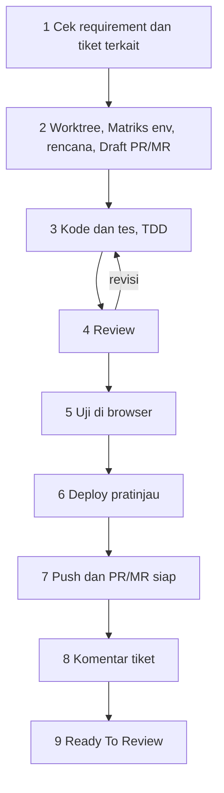

Kerjakan tiket di `$ARGUMENTS`. Sesi ini = **SPV**: ikuti `~/.agent-workflow/frontend-kit/agents/spv.md` (tidak menulis kode produk, tidak memindah ke Done).

Baca dulu (jangan disalin): `~/.agent-workflow/frontend-kit/skills/_shared/rules.md`, `board.md`, `browser.md`, `credentials.md`, `deploy-release.md`, `report-format.md`, dan `~/.agent-workflow/frontend-kit/agents/{planner,coder,reviewer,qa,release}.md`. Skrip: `$FRONTEND_WORKFLOW_DIR/bin/<skrip>`; `lock.sh`/`port-pick.sh` diawali `AGENT_LOCK_PID=$PPID`.

**Alur** (`--batch` default; terpisah dari `--solo`/`--tim`):
- **`--batch`:** semua tiket = satu batch: satu rencana, satu branch batch lokal, **satu build produksi + server preview** untuk QA, satu deploy pratinjau batch bila hosting memakai CLI. Proses berat jalan sekali untuk semua tiket, di **titik tunggu** langkah 5 dan 9.
- **`--separate`:** tiap tiket jalur sendiri: rencana, server QA dari worktree tiket, deploy pratinjau, laporan, selesai sendiri.
- **`--uat`:** sesudah QA lulus, user mencoba sendiri URL pratinjau; SPV menunggu "selesai UAT" dan mencatat temuan user (langkah 5b).

## Langkah
| # | Skill internal | Siapa | Hasil |
|---|---|---|---|
| 0 | `/setup-board`, `/setup-docs` | SPV | prasyarat; id **Ready To Review** ada; akun uji ada (`credentials.md`) |
| 1 | `/read-ticket`, `/sync-docs`, `/gate-validation` | SPV | gerbang lolos + **Acuan tiket** (+ Yang ditolak) |
| 2a | `/setup-worktree` | SPV | worktree + branch tiket, base hash, dependensi terpasang |
| 2b | `/matrix-env` | Contract Runner (tim) / SPV (solo) | Matriks env; beda kontrak → tanya sebelum rencana |
| 2c | `/write-plan` → `/write-report` (jenis `rencana`) | Planner (tim) / SPV (solo); SPV menerbitkan | dokumen rencana + test case |
| 2d | `/open-pr` mode `draft` (atau `revisi` untuk tiket dengan jejak) | Release | Draft PR/MR per tiket |
| 3 | `/implement-tdd` (+ `/mock-api` bila endpoint belum ada) | Coder | commit di-push rutin ke branch tiket |
| 4 | `/review-code` | Reviewer | komentar review di PR/MR; temuan wajib → kembali ke 3 |
| 5 | `/test-browser` + `/check-a11y` | QA | `report.md` + screenshot; gagal → kembali ke 3 |
| 6 | `/deploy-preview` | Release | URL pratinjau (+ env staging bila ada) |
| 7 | `/write-report` (jenis `uji`), lalu `/open-pr` mode `siap` | SPV, lalu Release | link laporan; PR/MR siap review |
| 8 | `/post-summary` | Release | komentar tiket (baris pertama link laporan) |
| 9 | `/move-ticket` ke Ready To Review | Release | tiket Ready To Review; tidak pernah Done |

## Aturan per langkah
- **1:** gerbang **tanya**/**berhenti** → tanya user dengan ringkasan + saran; tidak lanjut tanpa jawaban. Spec API/kontrak tidak ada di repo → tanya; jawabannya jadi blok `## Catatan agen`.
- **Mode:** `--solo`/`--tim` memaksa; tanpa flag → 1 tiket kecil = solo, selain itu tim. Solo: SPV sendiri menjalankan Coder → Reviewer (review diff sendiri, catat di laporan bahwa review tidak independen) → QA → Release, berurutan, sesuai file peran masing-masing.
- **Tim:** tiap worker = teammate (tool Agent, `name: "<Nama>-<Label><n>"`, `subagent_type`, `model`):
  | Peran | Model | Catatan |
  |---|---|---|
  | Planner | fable (jangan isi `model`) | langkah 2c dan saat eskalasi; dihentikan setelah membalas |
  | Contract Runner | `claude-sonnet-5-5` | langkah 2b |
  | Coder (1–5) | `claude-sonnet-5-5` | satu per tiket; ke-2+ di tiket sama hanya bila file terpisah |
  | Reviewer | `claude-opus-5-5` | bukan Coder tiket itu |
  | QA (1–3) | `claude-sonnet-5-5` | port + akun dari SPV |
  | Release | `claude-haiku-5-5` | |
  Isi tugas: "Ikuti `~/.agent-workflow/frontend-kit/agents/<peran>.md`", skill internal yang dijalankan, KODE, AC/TC, worktree + branch, batas file, port/akun, mockup per ukuran layar, folder laporan. Pantau sampai tuntas, hentikan teammate yang selesai (`rules.md` → Orkestrasi).
- **2c:** SPV memeriksa rencana terhadap kondisi nyata (port, batch, guard) sebelum membagi tugas. Planner **Tidak bisa** / tidak tersedia → SPV menulis sendiri dan mencatatnya.
- **3:** SPV menjawab daftar cek silang Coder (kontrak, desain per ukuran layar) dari Acuan + Matriks env; tidak ada jawaban → tanya user. Coder tidak bisa membaca tiket/dokumen: mockup dan kontrak disertakan di tugas.
- **4:** lewat 2 putaran revisi (tim) → Planner menganalisis akar masalah + revisi rencana; rencana sudah direvisi 2 kali dan masih gagal → berhenti dan tanya.
- **5 `--batch` (titik tunggu):** hanya setelah **semua** tiket lolos review atau dikeluarkan (alasan di rencana): di checkout domain `git checkout <branch batch>`, `git merge --no-ff <branch tiket>` per tiket (salinan lokal untuk uji; perbaikan selalu di branch tiket lalu merge ulang; konflik → berhenti dan tanya), lalu QA menguji semua tiket di satu build produksi + server preview. `--separate`: QA di worktree tiket begitu tiket itu lolos review.
- **5 gerbang selesai** per tiket: semua TC AC **Lulus** di semua ukuran layar wajib (atau **Tertahan** + alasan); a11y tanpa pelanggaran critical/serious baru; review tanpa temuan wajib; lint/typecheck/test/build lulus. Belum → ulangi 3–5 (`--batch`: perbaiki semua yang gagal dulu, satu build ulang). TC tidak bisa dijalankan / AC tidak teruji (tim) → Planner merevisi test case. Spec TC yang stabil → SPV menugaskan Coder menyalinnya ke suite (`@area-<modul>`), ikut direview di PR.
- **5b `--uat`:** setelah deploy pratinjau (langkah 6) SPV memberi user URL + akun uji (nama kunci) dan menunggu "selesai UAT". Temuan user → kembali ke 3 (Coder → Reviewer → QA). Tanpa `--uat` tidak ada langkah ini.
- **6:** deploy pratinjau **selalu**; env staging juga bila dipetakan; production tidak pernah di flow ini.
- **7:** tunggu link laporan; tanpa link → jangan komentar tiket.
- **Hotfix:** sementara manual — tanya user sebelum mulai.

## Bersihkan & ringkas
Hapus worktree tiket buatan batch ini yang sudah Ready To Review (syarat di `rules.md`); matikan semua server/mock; hentikan semua teammate; pastikan kunci (`port:*`, `account:*`, `checkout:*`, `deploy:*`) dilepas.
| KODE | Status | Laporan | Pratinjau | PR/MR |
|---|---|---|---|---|

## Berhenti lebih awal / galat
Sebelum berhenti (guard, tanya, galat, user membatalkan): lepas semua kunci milik batch ini, matikan server, minta teammate melakukan hal sama lalu hentikan, dan laporkan posisi terakhir per tiket.
