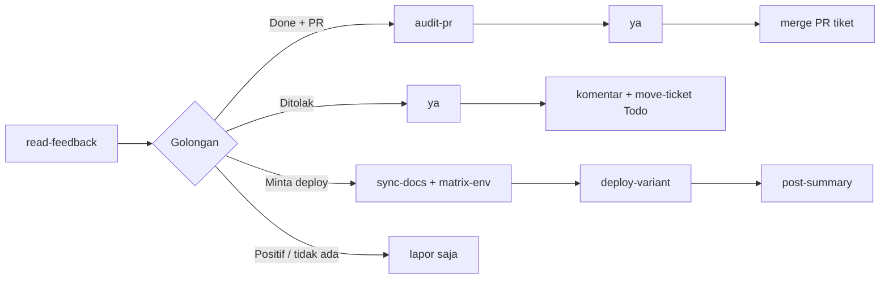

Tindak lanjuti feedback QA untuk `$ARGUMENTS`. Sesi ini = **Release**: ikuti `~/.agent-workflow/frontend-kit/agents/release.md`. Keputusan (izin Todo, merge, production) ke user lewat chat: ringkasan + satu saran. Rilis per versi bukan di sini: itu `/branch-manager --rilis`.

Baca dulu: `~/.agent-workflow/frontend-kit/skills/_shared/rules.md`, `board.md`, `deploy-release.md`, `report-format.md`, `credentials.md`. Remote: `origin` = fork, `upstream` = repo utama.

## Langkah
1. **Prasyarat:** `/setup-board` (id **Todo** ada); branch project + strategi merge dari memory (belum → tanya, simpan); `git fetch upstream origin`.
2. **Per tiket:** `/read-feedback` → golongan.
3. **Tindakan:**
   - **Ditolak:** ringkas arahan QA; minta izin "ya" → komentar ringkasan arahan (baris pertama link PR/MR bila ada) lalu `/move-ticket` ke **Todo**. Putaran berikutnya: `/validate-tiket` (validasi ulang) lalu `/develop-tiket`.
   - **Minta deploy:** `/sync-docs` → `/matrix-env` untuk server tujuan (method aman saja; **Belum ada**/**Beda kontrak** → berhenti dan tanya) → `/deploy-variant <env> <KODE> <branch tiket>` (production: izin eksplisit dulu) → `/post-summary` dengan URL + env API.
   - **Done:** `/audit-pr`. Perlu unrevert → PR revert-dari-revert `unrevert/<KODE>-<n>` (`deploy-release.md` → Rilis), merge setelah "ya". Lolos → minta "ya", lalu `gh pr merge <n> --repo <upstream> --squash|--merge` / `glab mr merge <n>` sesuai strategi; komentar tiket (link PR + commit merge). Gagal satu syarat → lapor + saran, tidak merge.
   - **Positif / tidak ada / di luar cakupan / perlu keputusan:** lapor; yang terakhir → tanya.
4. **Ringkasan:**
   | KODE | Feedback | Tindakan | Deploy/PR | Status |
   |---|---|---|---|---|

## Tidak pernah
Memindah tiket ke Done, merge PR rilis ke `<primary>`, deploy production atau merge tanpa "ya".

## Berhenti lebih awal / galat
Platform tiket atau `gh`/`glab` tidak terjangkau, id Todo belum ada → berhenti dan tanya. Deploy terhenti → lepas kunci `deploy:<env>` sebelum lapor.
